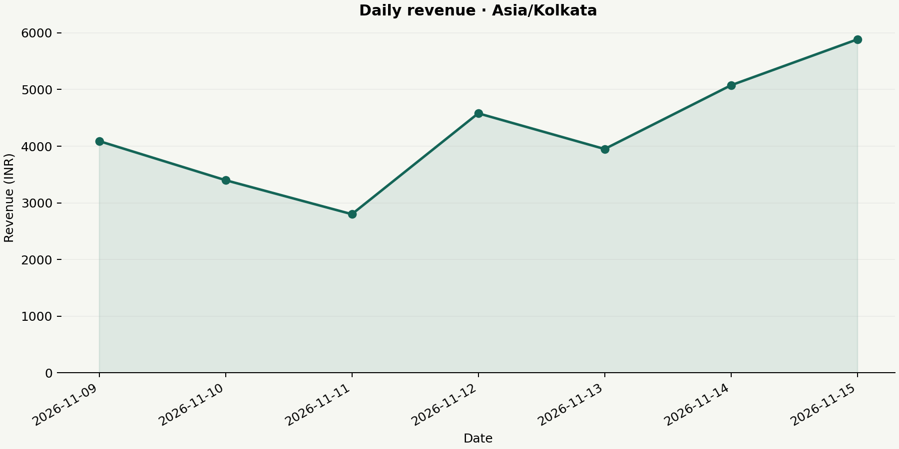

virudhigakv — College Canteen Ordering and Sales Analysis System

A complete canteen operator application for maintaining a menu, recording multi-item orders, calculating bills, updating stock, and understanding sales. It includes a browser interface, a runnable Java backend, an SQL database model, and a Python analysis pipeline.


## What the application does

- Registers canteen accounts, signs in with a mobile number and password, and supports logout.
- Keeps each account's menu, stock, orders and reports separate.
- Provides explicitly labelled, same-browser demo OTP password recovery; no SMS is sent in demo mode.
- Maintains food names, categories, descriptions, prices, availability and stock.
- Builds orders with multiple items and calculates the bill in INR.
- Saves each completed order and all its line items atomically with stock deductions.
- Rejects invalid quantities and orders exceeding current stock; retries cannot charge stock twice.
- Preserves receipt names and prices when the menu changes later.
- Displays dashboard totals, order history, daily revenue and popular items.
- Exports sales lines for Python preprocessing and chart generation.
- Includes SRS, design/ER diagrams, relational model, normalization, SQL, tests and sample inputs/outputs.

Payment method is a recorded label: choosing Cash, UPI or Card does not collect or verify money. There are no taxes or extra fees in this assignment.

## Technologies and deployment modes

| Component | Technology |
| --- | --- |
| Browser interface | HTML, CSS, browser JavaScript, accessible SVG charts |
| Local academic backend | Java 17+, JDK HTTP server, SQLite JDBC, Gson |
| Local database | SQLite, foreign keys, transactions, parameterized SQL |
| Hosted web application | JavaScript Cloudflare Worker and persistent D1 SQL database |
| Offline analysis | Python 3.10+, pandas, Matplotlib, sqlite3 |
| Design documentation | Markdown and Mermaid diagrams |

The **Java backend is runnable and serves the same interface and API** as the hosted app. The hosting platform executes a JavaScript Worker, not a JVM. Local SQLite and hosted D1 are separate databases and do not automatically synchronize. Python can read the local SQLite database or a CSV exported from the hosted app.

## Accounts and password recovery

Create an account with your **canteen name, owner name, mobile number, GST number and password**. For this classroom demo, any 10-digit mobile number and exactly 15 letters or digits for GST are accepted; an optional +91 mobile prefix is normalized. Demo examples are `1234567890` and `1234567890OKJHG`. These checks do not verify phone ownership or government GST registration. Passwords must contain 8–128 characters. Field messages explain incomplete input without a generic browser format popup.

Every new account receives its own **12 starter menu items and zero orders**. Menu edits and completed sales are visible only after signing in to that account. Logout clears the operator interface and revokes the current server session. Previously unassigned sample records remain archived in the database; signing up never claims them.

The default recovery mode is a **demo OTP**, explicitly labelled **“no SMS was sent.”** After creating or signing in to an account, use Forgot password in that same browser. The server displays a six-digit demo code only to that previously authorized browser. Enter it with a new password within 10 minutes; at most five code attempts are permitted. Successful reset revokes all sessions and recovery devices, then you sign in again. Another browser, cleared cookies or an expired recovery cookie cannot use demo recovery. This is a classroom demonstration of the reset flow, not proof of mobile ownership.

Real SMS delivery requires configuring Twilio Verify and explicitly selecting SMS mode. No SMS credentials are included. See [account and recovery guide](docs/AUTHENTICATION.md) for cookie behavior, validation, limitations and environment-variable names.

## Run the Java application

Requirements: a full **JDK 17 or later**, Bash, `curl`, and `sha256sum`. Maven is not required. On Windows use WSL, or another environment providing these commands.

From the project root:

```sh
bash java/run.sh
```

The build script downloads four pinned, checksum-verified dependencies from Maven Central into ignored `java/lib/`, compiles the source, then starts the server at **http://127.0.0.1:8080**. Open that address in a browser. The default persistent database is `data/canteen.db`.

First startup initializes the SQL schema and authentication tables. Open the app and create your canteen account. Restarting preserves accounts, orders, menu changes and remaining stock. To use another port or database:

```sh
bash java/run.sh --port 8081 --db data/another-canteen.db
```

The local server binds to loopback by default. Account authentication protects the data APIs; use HTTPS when hosting beyond local development. See [Java implementation details](docs/JAVA.md).

For the hosted Worker implementation's local development server, use Node.js 22.13 or later and run `npm run dev`. Its default address is `http://127.0.0.1:5173` and its local database is separate from Java's. `npm test` runs the Worker API and authentication tests; `npm run build` creates the deployment artifact.

## Synthetic analysis dataset

The bundled analysis fixture contains **12 menu items and 219 sample orders for November 9–15, 2026**. Those orders have `is_demo=1`; newly entered orders have `is_demo=0`. This standalone fixture is for offline demonstrations. It is not loaded into a newly registered account. Historical unassigned rows in an upgraded database retain a null `account_id` and remain hidden from account data APIs.

The included sample database [samples/canteen-demo.db](samples/canteen-demo.db) is for analysis and reproducible demonstrations. Its generated report totals are **671 units and ₹29,780.00**. These figures are examples, not real college revenue.

## Run the Python analysis

```sh
python -m venv .venv
. .venv/bin/activate
python -m pip install -r requirements.txt
python analysis/analyze_sales.py --db data/canteen.db --account-id YOUR-ACCOUNT-ID --out analysis/output
```

On Windows activate with `.venv\Scripts\activate`. Run the Java app once first to create `data/canteen.db`, or create a separate demonstration database explicitly:

```sh
python analysis/init_demo.py --db data/analysis-demo.db
python analysis/analyze_sales.py --db data/analysis-demo.db --out analysis/output
```

`init_demo.py` refuses to overwrite an existing database. The legacy fixture has no account column and is analyzed without `--account-id`. For a current multi-account database, select your account ID when creating a report. It is available from the signed-in `/api/auth/session` response or to the database administrator. The CLI is an offline administrator tool: filesystem access is required, and this optional filter does not authenticate a user. Omitting it reads all accounts and archived records. To analyze one account's new orders over a date interval:

```sh
python analysis/analyze_sales.py --db data/canteen.db --account-id YOUR-ACCOUNT-ID --start 2026-11-09 --end 2026-11-15 --exclude-demo
```

For hosted records, sign in and choose **Sales reports → Export CSV**. This export already contains only your account's sales, so it needs no account filter:

```sh
python analysis/analyze_sales.py --csv path/to/canteen-sales.csv --out analysis/output
```

The pipeline reads joined transaction records, validates integer quantities/prices and line totals, parses timestamps, deduplicates on the correct order/item key, quarantines invalid/conflicting rows, and aggregates reporting days in **Asia/Kolkata**. It writes cleaned/rejected CSVs, item and daily summaries, a JSON report, and three PNG charts. See [analysis instructions](analysis/README.md) and [generated sample output](samples/analysis/summary.json).



## Verification

```sh
bash java/build.sh
python tests/java_api_test.py
python -m unittest discover -s analysis -p 'test_*.py' -v
npm test
```

Java tests create a temporary database and test HTTP behavior without touching your application database. Python tests cover multiple items per order, exact/conflicting duplicates, invalid data, India midnight, missing days, renamed items, empty reports and account-specific database/CSV filtering. See [the testing document](docs/TESTING.md) for executed results and manual checks.

## Project structure

```text
web/                  Shared browser UI
java/src/             Java HTTP + SQLite implementation
java/build.sh         Dependency verification and compilation
java/run.sh           Local application launcher
server/               Hosted Worker implementation
scripts/              Hosted build/dev and fixture helpers
.openai/hosting.json   Hosted deployment configuration
database/schema.sql   Base sales schema and indexes
database/auth.sql     Account tables and nullable ownership migration
database/seed.json    Synthetic menu and sales fixtures
analysis/             Database retrieval, preprocessing, charts and tests
docs/                 SRS, diagrams, normalization, SQL and testing
samples/              Example database, requests/results and generated charts
tests/                Backend integration checks
```

## GitHub submission checklist


| Required deliverable | Included location |
| --- | --- |
| SRS | [docs/SRS.md](docs/SRS.md) |
| Architecture, class, use-case and sequence diagrams | [docs/DESIGN.md](docs/DESIGN.md) |
| Accounts and demo/SMS recovery | [docs/AUTHENTICATION.md](docs/AUTHENTICATION.md) |
| Test plan and observed results | [docs/TESTING.md](docs/TESTING.md) |
| Java source and execution instructions | `java/`, [docs/JAVA.md](docs/JAVA.md) |
| Sample inputs and outputs | `samples/`, `samples/analysis/` |
| ER diagram, relational model and normalization | [docs/DATABASE.md](docs/DATABASE.md) |
| Executable SQL and reporting queries | `database/schema.sql`, `database/auth.sql`, [docs/SQL-REPORTS.md](docs/SQL-REPORTS.md) |
| Python retrieval, preprocessing and visualization | `analysis/` |
| Description, technologies and execution instructions | This README |

From your local extracted project, after creating an empty GitHub repository:

```sh
git init
git add .
git commit -m "Add canteen ordering and sales analysis project"
git branch -M main
git remote add origin https://github.com/YOUR-USERNAME/YOUR-REPOSITORY.git
git push -u origin main
```

Replace the repository URL with your own. If the folder is already a Git checkout with an `origin`, inspect it first with `git remote -v`; use a fresh source copy for your individual submission. No GitHub repository is created by these files alone.
