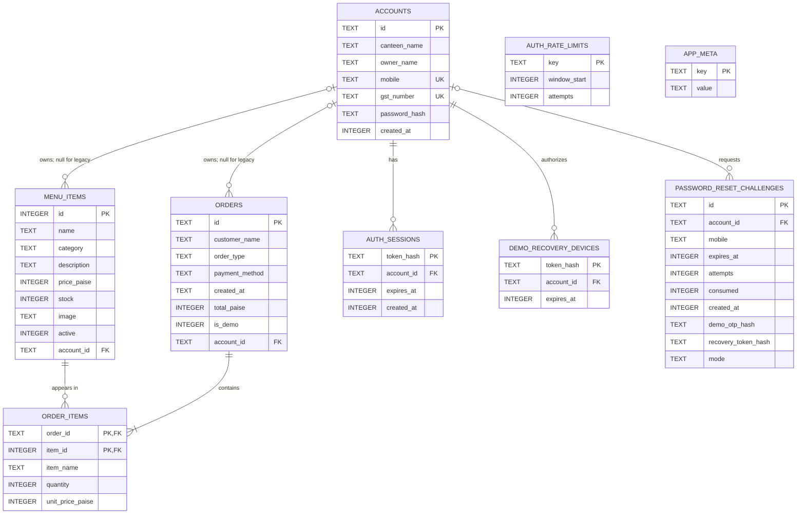

# Database design, relational model, and normalization

## 1. Database engines and units

The Java application uses SQLite through JDBC. The hosted application uses Cloudflare D1, which follows SQLite's SQL model. They use the same logical schema and API but maintain separate data. The base schema is `database/schema.sql`; `database/auth.sql` adds authentication tables and nullable account ownership columns through an ordered migration. Apply each migration once; the ALTER statements are not rerunnable initializers. This document describes the combined model.

Prices and totals are integer paise. Quantities and stock are integers. Sale timestamps are ISO-8601 UTC strings. Authentication creation/expiry/window timestamps use integer Unix seconds. Convert timestamps to Asia/Kolkata before grouping daily revenue.

## 2. ER diagram



A completed order has at least one line by the service's transaction rules. Foreign keys alone do not enforce that minimum. `app_meta` is operational metadata and has no relationship to sales entities.

## 3. Relational model

| Relation | Attributes | Keys and constraints |
| --- | --- | --- |
| `menu_items` | `id, name, category, description, price_paise, stock, image, active, account_id` | PK `id`; non-null required attributes; `price_paise > 0`; `stock >= 0`; `active` indicates availability for new sales. |
| `orders` | `id, customer_name, order_type, payment_method, created_at, total_paise, is_demo, account_id` | PK `id`; `total_paise > 0`; required header attributes. ID is also the idempotency key. |
| `order_items` | `order_id, item_id, item_name, quantity, unit_price_paise` | Composite PK `(order_id, item_id)`; FK `order_id → orders.id`; FK `item_id → menu_items.id`; `quantity > 0`; `unit_price_paise > 0`. |
| `accounts` | `id, canteen_name, owner_name, mobile, gst_number, password_hash, created_at` | PK `id`; unique `mobile` and `gst_number`; required values; password hash only. |
| `auth_sessions` | `token_hash, account_id, expires_at, created_at` | PK `token_hash`; FK `account_id → accounts.id`; only token hash is persisted. |
| `demo_recovery_devices` | `token_hash, account_id, expires_at` | PK `token_hash`; FK `account_id → accounts.id`; 30-day prior-browser authorization. |
| `password_reset_challenges` | `id, account_id, mobile, expires_at, attempts, consumed, created_at, demo_otp_hash, recovery_token_hash, mode` | PK `id`; nullable FK `account_id → accounts.id`; a null account supports a dummy SMS-mode challenge; expiry/use/attempt rules enforced atomically by service. |
| `auth_rate_limits` | `key, window_start, attempts` | PK hashed `key`; fixed-window attempt counter. |
| `app_meta` | `key, value` | PK `key`; records one-time initialization state. |

`menu_items.account_id` and `orders.account_id` are nullable foreign keys to `accounts.id`; null preserves pre-account rows without granting access. All new account records carry the authenticated owner ID. `order_items` inherits ownership through its parent order; the service also verifies ownership of its menu reference. The two independent foreign keys alone do not enforce that cross-table owner match.

A menu item is deactivated instead of deleting its referenced history. Multiple separate orders may contain the same item. Repeated references to an item within one request are aggregated into one order line.

`customer_name` is a sale label, not a foreign key into a customer identity table. A separate customer table would imply identity management that this project does not provide. Categories and payment methods are bounded display values, not independently administered entities.

## 4. Functional dependencies

- `menu_items.id → name, category, description, price_paise, stock, image, active, account_id`
- `orders.id → customer_name, order_type, payment_method, created_at, total_paise, is_demo, account_id`
- `(order_items.order_id, order_items.item_id) → item_name, quantity, unit_price_paise`
- `accounts.id → canteen_name, owner_name, mobile, gst_number, password_hash, created_at`; unique mobile and GSTIN are alternate keys.
- `auth_sessions.token_hash → account_id, expires_at, created_at`
- `demo_recovery_devices.token_hash → account_id, expires_at`
- `password_reset_challenges.id → account_id, mobile, expires_at, attempts, consumed, created_at, demo_otp_hash, recovery_token_hash, mode`
- `auth_rate_limits.key → window_start, attempts`
- `app_meta.key → value`

The sale-time `item_name` and `unit_price_paise` are snapshots. Current `menu_items.id` does not determine a single historical price across all order lines: the same item can be sold at different prices on different dates. Likewise, a later rename does not rewrite its earlier bill label. The snapshot attributes therefore belong to the sale-line fact, not to the current catalog definition.

## 5. Normalization

### Unnormalized example

A paper bill might store:

`Bill(id, date, customer, items=[(name, price, quantity), ...], total, payment)`

The repeating item group makes individual item aggregation and constraints difficult.

### First normal form (1NF)

Separate bill headers from line items. Store one scalar value in each column and one item line per `(order_id, item_id)`. There is no comma-separated list of item names or quantities in the database. Menu items also have one row per product.

### Second normal form (2NF)

The order header has a single-column key and stores header facts only. The order-lines table has a composite key. Quantity and sale-time name/price describe a specific item within a specific order, so they depend on the whole key. Current stock, description, and category depend on `item_id` alone and are stored in `menu_items`, not copied into each sale line.

### Third normal form (3NF)

Non-key header facts depend on the order ID, catalog facts depend on the menu ID, and sale-line facts depend on the line key. The schema avoids storing unrelated derived customer/category metadata on transactions. It does not introduce a supplier or student entity whose attributes would create transitive dependencies.

Two intentional choices need explanation:

1. **Historical snapshots:** `item_name` and `unit_price_paise` preserve the receipt as sold. They are historical attributes, not accidental copies of today's menu. This allows price/name changes without altering earlier reports or bills.
2. **Cached total:** `orders.total_paise` equals the sum of `quantity × unit_price_paise` for its lines. Although each table's key dependencies remain straightforward, this is deliberate aggregate redundancy across relations. The server calculates it and writes it with all lines in one transaction. A reconciliation query below verifies the invariant. Do not accept totals supplied by the browser.

Normalization does not by itself prevent overselling or guarantee the header/line total invariant. Those require transaction logic and integrity checks.

## 6. Transaction rules

A new sale must atomically perform all of the following:

1. Resolve a valid session and use its account ID for every lookup and mutation; validate the request and combine repeated item IDs.
2. Reject an existing order ID with changed content; return the original receipt for an equivalent retry.
3. Resolve active menu items and their authoritative prices.
4. Ensure all requested quantities are available while protecting against concurrent stock changes.
5. Decrement stock, insert the order header, and insert every order line.
6. Commit only if every operation succeeds; otherwise roll back everything.

Foreign key enforcement must be enabled on SQLite connections. Use parameter binding instead of concatenating customer text into SQL. The schema is installed before normal request handling; initial demonstration records are data seeding, not schema migration.

## 7. Example analytical queries

These examples are offline administrator queries over the database file and are not authorization endpoints. For one account, bind `WHERE account_id = ?` on orders/menu, or join order lines to orders and bind `WHERE o.account_id = ?`; never trust a requested account ID instead of the authenticated session in the web API. Python offers `--account-id` as a convenience filter only.

### Item quantities and revenue

```sql
SELECT item_id, item_name,
       SUM(quantity) AS units_sold,
       SUM(quantity * unit_price_paise) AS revenue_paise
FROM order_items
GROUP BY item_id, item_name
ORDER BY units_sold DESC, item_id;
```

Grouping by name in this query keeps historical names distinct. To rank a logical menu item across renames, aggregate by `item_id` and choose a documented display label in the report.

### Daily revenue in India

```sql
SELECT date(created_at, '+5 hours', '+30 minutes') AS business_date,
       COUNT(*) AS order_count,
       SUM(total_paise) AS revenue_paise
FROM orders
GROUP BY business_date
ORDER BY business_date;
```

Asia/Kolkata currently has the fixed offset used in this SQLite example. Python uses the named timezone for consistency.

### Header-total reconciliation

```sql
SELECT o.id, o.total_paise,
       COALESCE(SUM(oi.quantity * oi.unit_price_paise), 0) AS calculated_paise
FROM orders o
LEFT JOIN order_items oi ON oi.order_id = o.id
GROUP BY o.id, o.total_paise
HAVING o.total_paise <> COALESCE(SUM(oi.quantity * oi.unit_price_paise), 0);
```

A healthy database returns no rows. This also catches a positive-total order with no lines.

### Stock and missing-link checks

```sql
SELECT id, name, stock FROM menu_items WHERE stock < 0;
PRAGMA foreign_key_check;
```

### Exclude demonstration sales

```sql
SELECT SUM(total_paise) AS entered_sales_paise
FROM orders
WHERE is_demo = 0;
```

The offline historical dataset is synthetic and marked `is_demo = 1`. New accounts start with 12 menu items and zero orders; new orders use `is_demo = 0`. Legacy rows retain `account_id = NULL`, are never auto-claimed, and remain hidden from account APIs. Initialization must never restore consumed stock or duplicate samples.


## 8. Authentication normalization and lifecycle

Account identity attributes live in `accounts` rather than being copied into menu and sale rows. Separate session and recovery-device relations support multiple devices without repeating account details. Rate-limit counters form an independent operational relation keyed by a hash of their scope. Password hashes are salted PBKDF2-HMAC-SHA256 (100,000 iterations); session and device bearer values are stored only as SHA-256 hashes. APIs return a public projection of accounts that excludes the password hash.

The challenge relation deliberately retains the requested mobile as a snapshot, including dummy requests for unknown numbers in SMS mode. For a known account this can repeat its current mobile; it is intentional protocol/audit context, not a reason to claim the authentication extension is strictly redundancy-free. `recovery_token_hash` identifies the authorizing browser snapshot, but is not a foreign key: successful reset removes devices while retaining the consumed challenge. `demo_otp_hash` is SHA-256 of the challenge ID, a colon, and its six-digit code. Demo code plaintext exists only for the authorized same-browser response, not as a database column.

A reset atomically replaces the password hash, deletes all account sessions and recovery devices, and marks the valid unused challenge consumed. Expiry, attempt count and consumption conditions prevent reuse. Logout deletes the current session but intentionally keeps the browser recovery device until its 30-day expiry or a successful reset. The default demo mode proves prior browser possession and sends no SMS; optional Twilio Verify mode requires server-side configuration.

Authentication migration adds nullable ownership columns to preserve older records. It does not backfill ownership or seed orders into newly registered accounts. For reporting, an administrator may inspect null-owned historical records offline, but ordinary authenticated APIs must filter strictly by the resolved account ID. The application service enforces owner consistency between order headers and referenced menu items; a future schema can add composite ownership keys if database-level cross-owner enforcement is required.
