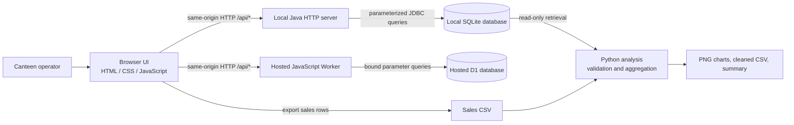
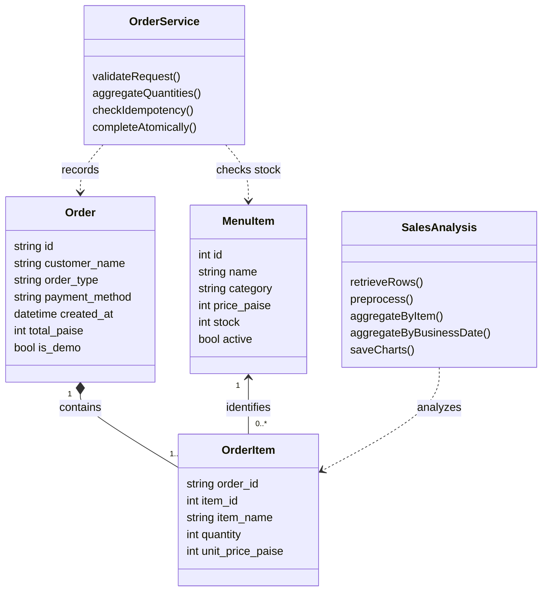
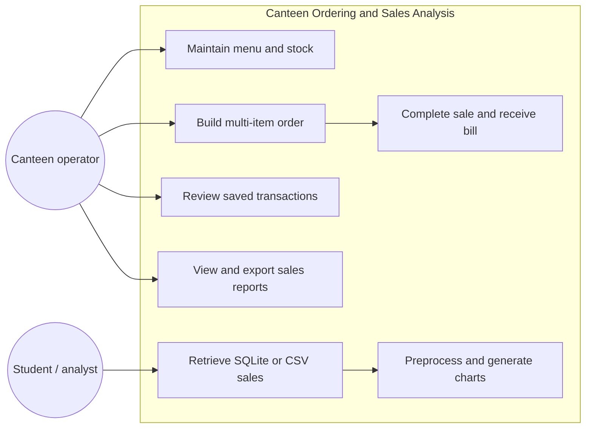
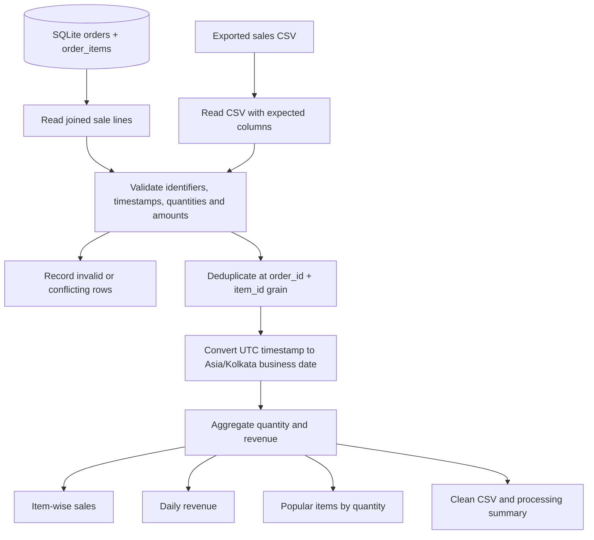

# System design

## 1. Deployment architecture

The same browser interface uses the same relative `/api/` endpoints in two independently runnable installations. An initial session request selects the signed-out authentication screens or the authenticated canteen workspace. All business API reads and writes require a session and are scoped to its account ID. The academic backend runs Java with SQLite. The hosted web app runs JavaScript in a Cloudflare Worker with D1. The hosted app does **not** execute Java or Python. Python is a separate analysis workflow that reads local SQLite or a downloaded sales CSV.



The two database boxes are not replicas. A transaction recorded in the hosted Site is available to Python through export; it does not appear automatically in the local Java database. The deployment's private Site access gate controls access to the hosted app; application login separately selects and authorizes a canteen account. A payment method is stored as descriptive metadata; there is no payment gateway integration.

## 2. Component responsibilities

| Component | Responsibility |
| --- | --- |
| Authentication | Register accounts, verify passwords, create/revoke server sessions, and expose only public account fields. |
| Password recovery | Use browser-bound demo challenges by default; optionally call Twilio Verify in configured SMS mode. |
| Menu view | Search and categorize available items; display price and stock. |
| Cart and checkout | Collect quantities, customer label, order type, and payment method; maintain a stable ID while retrying the same order. |
| Menu administration | Add/edit items, adjust available stock, and deactivate menu entries. |
| Order API | Validate requests, aggregate repeated items, recalculate prices, enforce stock, and commit a complete sale. |
| Report views | Read saved sales, select a reporting range, draw charts, and export rows. |
| Database | Persist catalog, sale headers and lines, and initialization metadata; enforce key/value constraints. |
| Python workflow | Retrieve/export input, preprocess with a documented policy, summarize sales, and write visualizations. |

## 3. Conceptual domain class diagram

This diagram describes the domain and responsibilities; the labels are conceptual, not a promise of identically named source classes.



## 4. Use-case diagram



## 5. Checkout sequence and failure behavior

```mermaid
sequenceDiagram
    actor Operator
    participant UI as Browser
    participant API as Java or Worker API
    participant DB as SQLite or D1
    Operator->>UI: Select items and complete order
    UI->>API: POST /api/orders with stable UUID and quantities
    API->>API: Validate fields and combine repeated item IDs
    API->>DB: Look up order UUID
    alt Existing UUID and same normalized order
        DB-->>API: Original header and lines
        API-->>UI: Existing receipt; no new stock change
    else Existing UUID with different contents
        API-->>UI: 409 conflict
    else New UUID
        API->>DB: Atomically validate stock and record sale
        Note over API,DB: Prices come from database; stock cannot become negative
        alt Active items and sufficient stock
            DB->>DB: Deduct stock; insert header and all lines
            DB-->>API: Commit succeeds
            API-->>UI: Stored receipt
            UI-->>Operator: Confirm sale and refresh stock/reports
        else Invalid availability or transaction failure
            DB->>DB: Roll back all changes
            API-->>UI: Validation/conflict error
            UI-->>Operator: Explain issue; retain editable cart
        end
    end
```

Database-specific transaction mechanisms differ between Java/JDBC and the hosted Worker. Both must ensure that the check and mutation cannot permit concurrent overselling. A preliminary browser stock check is only feedback; it is not the integrity boundary.

## 6. Data flow for sales analysis



Amounts remain integer paise through validation and aggregation. Graph labels convert to rupees. A quantity ranking measures portions sold, not number of distinct buyers. Daily revenue uses the India business day, avoiding midnight errors from grouping raw UTC timestamps.

## 7. Interface design

Navigation separates Overview, New order, Menu & stock, Sales reports, and Project docs. The overview prioritizes current sales, popular items, recent orders, and low stock. The order screen makes quantity and availability visible near each item. The receipt uses the committed server values. Forms and tables expose real validation/loading/error states, and layouts adapt to smaller screens.

Each new account receives 12 initial menu items and has no orders. Legacy/sample rows with `account_id = NULL` are retained without automatic assignment and are hidden from account APIs. Offline sample transactions remain marked `is_demo = 1`; account-created sales use `is_demo = 0`. Exported data preserves the flag for reproducible analysis. The recovery screen explicitly says that demo codes do not send SMS. Dates and currency have consistent formatting; customer text and item names are rendered as text rather than executable markup.

## 8. Design limits

The application supports separate authenticated canteen accounts but has no delegated staff roles within an account, purchasing/ingredient model, or refund ledger. Changing stock is an operator correction, not a separate inventory-movement audit. A future production version should model staff permissions, stock movements, backups, and refunds explicitly. Demo password recovery establishes prior browser possession, not mobile ownership, and cannot recover an account from a new browser after its recovery cookie is lost. Real SMS recovery requires configuration and provider availability.


## 9. Account and session design

Registration validates canteen/owner names (2–100 characters), normalizes any 10-digit mobile number, validates GST as exactly 15 alphanumeric characters for the demo, and accepts an 8–128 character untrimmed password. GSTIN validation is not a government registry lookup. The account and its 12 initial menu entries are inserted atomically; no demonstration orders are inserted for the account.

The server derives all ownership from the authenticated session, never a client-supplied `account_id`. Menu lookups, stock changes, existing-order retries, transaction queries, and sales joins must retain that scope. Historical rows with null ownership remain intact and inaccessible through account APIs. Order line ownership follows its parent order, and the service verifies that every referenced menu item belongs to that same account.

Passwords use salted PBKDF2-HMAC-SHA256 with 100,000 iterations, 16-byte random salts and 32-byte output. The session cookie contains a random 256-bit bearer token; only its SHA-256 hash is stored. Cookies are HttpOnly, SameSite=Strict, Secure on HTTPS, scoped to `/`, and valid for seven days. Login/registration also set a separate 30-day recovery-device cookie. Logout deletes the authenticated session and clears UI/cart data; it intentionally preserves that recovery cookie.

```mermaid
sequenceDiagram
    actor Owner
    participant UI as Browser
    participant API as Authentication API
    participant DB as Account database
    Owner->>UI: Register canteen or enter mobile/password
    UI->>API: POST register or login
    API->>API: Validate input and enforce rate limits
    alt Registration
        API->>DB: Insert account + 12 menu items atomically
    else Login
        API->>DB: Find account by normalized mobile
        API->>API: Verify salted password hash
    end
    API->>DB: Store hashed session and recovery-device tokens
    API-->>UI: Public account fields + HttpOnly cookies
    UI->>API: Authenticated menu/order/sales request
    API->>DB: Resolve session and query only its account
    DB-->>API: Account-owned records
    API-->>UI: Protected response
    Owner->>UI: Logout
    UI->>API: POST logout
    API->>DB: Delete current authenticated session
    API-->>UI: Expire session cookie; retain demo recovery cookie
    UI->>UI: Clear account state and cart; display sign-in screen
```

## 10. Password recovery design

`AUTH_RECOVERY_MODE` defaults to the user-approved `demo` mode. A CSPRNG generates a six-digit code; the response exposes it as `demo_otp` only after checking a matching, unexpired recovery-device cookie for the requested account. The UI labels it “Demo code only — no SMS was sent.” The database stores the hash of `challenge_id + ':' + code`, never the plaintext code. A new challenge supersedes previous active challenges for that account.

```mermaid
sequenceDiagram
    actor Owner
    participant UI as Previously signed-in browser
    participant API as Recovery API
    participant DB as Account database
    Owner->>UI: Request password reset for mobile
    UI->>API: POST forgot-password + recovery cookie
    API->>DB: Verify recovery-device hash, account and expiry
    alt No valid device for this account
        API-->>UI: 403 same-browser requirement; no demo code
    else Authorized prior browser
        API->>API: Rate limit and generate six-digit code
        API->>DB: Save challenge hash, device hash and 10-minute expiry
        API-->>UI: Challenge ID + labelled demo code; no SMS
        Owner->>UI: Enter code and new password
        UI->>API: POST reset-password + same recovery cookie
        API->>DB: Check mode, device, expiry and attempts; reserve attempt
        API->>API: Compare code hash; hash new password
        alt Valid unused challenge
            API->>DB: Atomically change password, revoke sessions/devices, consume challenge
            API-->>UI: Clear cookies; require fresh login
        else Incorrect, expired or used code
            API-->>UI: Error; at most five verification attempts
        end
    end
```

Optional `AUTH_RECOVERY_MODE=sms` uses Twilio Verify with server-only `TWILIO_ACCOUNT_SID`, `TWILIO_AUTH_TOKEN`, and `TWILIO_VERIFY_SERVICE_SID`. It never returns a real SMS code in the API response. Missing configuration or failed sends produce an explicit service error. Unknown numbers receive a generic challenge response in configured SMS mode. Demo mode instead requires evidence of the prior same-account browser. Mode changes invalidate incompatible pending challenges. Recovery challenges expire after 600 seconds, permit at most five attempts, and are consumed atomically. Successful reset revokes every session and recovery device for that account and does not automatically sign in.

Rate limits apply to login, registration, forgotten-password requests and reset attempts; rate keys hash identifying inputs. Session expiry returns 401 on protected requests, and the UI returns to sign-in without retaining account data. Python's optional `--account-id` filter selects records during offline analysis; file access, not that argument, determines who can read a database.
